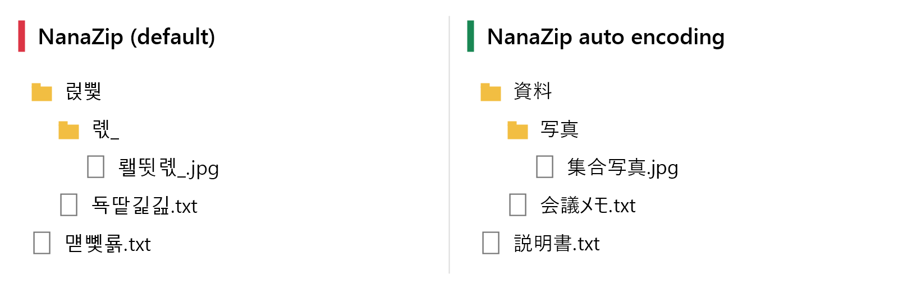
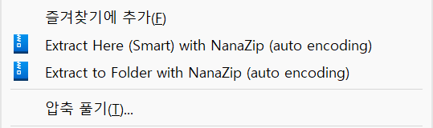
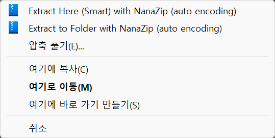
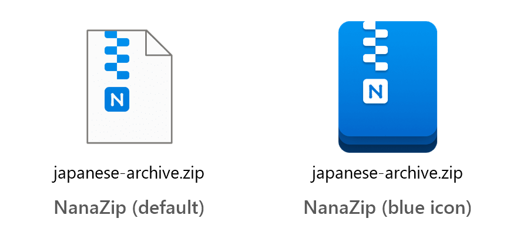

# NanaZip auto encoding

English | [한국어](README.ko.md)

Explorer right-click and right-drag menu items that extract archives with [NanaZip](https://github.com/M2Team/NanaZip) and pick the ZIP file name encoding automatically, so archives made on Japanese Windows (Shift-JIS) no longer come out with garbled names on Korean or English Windows.



The same archive extracted on Korean Windows, by NanaZip's default and by this add-on.

## Why

ZIP files made by older Windows tools store file names in the creator's legacy code page and do not record which one. NanaZip decodes those names with the system code page, so a Shift-JIS archive opened on Korean Windows shows `긡긚긣` where it should show `テスト`.

NanaZip's extractors decode them correctly when given the code page, for example `NanaZipC x archive.zip -mcp=932`, but the GUI has no option for it yet ([M2Team/NanaZip#325](https://github.com/M2Team/NanaZip/issues/325)). This add-on detects the code page and passes it for you.

## What you get

- **Right-click `.zip` files:**
  - **Extract Here (Smart) with NanaZip (auto encoding):** a single top-level folder or file goes right next to the archive, unless something with that name is already there; anything else goes into a new folder named after the archive.
  - **Extract to Folder with NanaZip (auto encoding):** always into a new folder named after the archive.

  

- **Right-drag archives onto a folder** (drag with the right mouse button, then drop): the same two items extract into the folder you dropped on. This works for common archive types (zip, 7z, rar, tar, gz, xz, zst, cab, iso and more). NanaZip itself has no right-drag menu.

  

- **Optional blue archive icon:** a "NanaZip (blue icon)" app for all 62 archive and disk image types NanaZip opens (zip, 7z, rar, tar, gz, iso, vhdx and more). Pick it as the default app for a type, and files of that type open in NanaZip and show NanaZip's blue app icon instead of its white page icon.

  

Details:

- When the new folder's name is taken, a number is added: `name (2)`.
- Several selected archives are extracted one after another by a single run.
- `.tar.gz`, `.tgz`, `.tar.xz` and similar are unpacked all the way, not just to the `.tar`.
- The extraction itself is done by NanaZip's GUI extractor (`NanaZipG`).
- Menu labels are in English or Korean.
- Everything is installed for the current user only, without admin rights.

The screenshots come from Korean Windows (the system's own items are in Korean) with the add-on installed in English.

## Install

1. Install NanaZip from the Microsoft Store or with `winget install M2Team.NanaZip`.
2. Download `nanazip-auto-encoding.zip` from [Releases](../../releases) and extract it.
3. Right-click `Install-NanaZipAutoCP.ps1` and choose **Run with PowerShell**, or run:
   ```
   powershell -ExecutionPolicy Bypass -File Install-NanaZipAutoCP.ps1
   ```
   A message box reports the result. The menu language follows the Windows display language; add `-Language en` or `-Language ko` to choose.
4. Optional, for the blue icon: open **Settings > Apps > Default apps > NanaZip (blue icon)** and pick it under each type you want. Or right-click an archive and choose **Open with > Choose another app > NanaZip (blue icon)**, then **Always**. Windows lets only you pick default apps, one type at a time.

On the Windows 11 compact context menu, the right-click items are under **Show more options**.

To uninstall, run this in PowerShell:

```
powershell -ExecutionPolicy Bypass -File "$env:LOCALAPPDATA\NanaZipAutoCP\Install-NanaZipAutoCP.ps1" -Uninstall
```

In Command Prompt, write `%LOCALAPPDATA%` instead of `$env:LOCALAPPDATA`. If Explorer still has the menu DLL loaded, the folder is deleted at your next sign-in. If you picked "NanaZip (blue icon)" as the default app for some types, pick another one for them afterwards.

## How the encoding is detected

Detection only looks at files with the `.zip` extension. Other formats are extracted with NanaZip's default decoding: 7z and RAR5 store Unicode names, and RAR4 and TAR, which can carry legacy names, are not handled.

1. Entries flagged as UTF-8, entries with an Info-ZIP Unicode Path field whose checksum matches the name, and plain ASCII names are left to NanaZip.
2. The remaining names are decoded as UTF-8, Shift-JIS (932) and CP949 (949), and each reading is scored by how much it looks like real file names:
   - invalid byte sequences score strongly down;
   - kana, common KS X 1001 Hangul, CJK ideographs, accented Latin letters and combining accents score up;
   - the typical look of a wrong guess scores down. CP949 read as Shift-JIS turns into half-width katakana, and Shift-JIS read as CP949 turns into Hangul syllables from the rarely used UHC extension block (`テスト` becomes `긡긚긣`).
3. The highest score wins, and ties go to CP949, then Shift-JIS. If no reading scores above zero, NanaZip's default is kept.

## Limitations

- Only UTF-8, Shift-JIS and CP949 are considered. Chinese GBK names, for example, can be read as CP949, so the add-on is not recommended on Windows set to a Chinese or other locale with its own legacy code page.
- Names written only in half-width katakana are detected as CP949.
- UTF-8 names without the UTF-8 flag whose only non-ASCII characters are accented Latin letters, such as `café.txt`, tie with CP949 and are read as CP949. ZIP files from macOS, which use combining accents, are detected as UTF-8.
- The menu DLL is built for x64 only, so the menus are not available on Windows on ARM.
- Tested on Windows 11 x64 with NanaZip 7.0.

## Files

| File | Purpose |
| --- | --- |
| `Install-NanaZipAutoCP.ps1` | Installs or removes everything for the current user. Must stay UTF-8 with a BOM, or Windows PowerShell 5.1 misreads its Korean labels. |
| `Expand-ArchiveAuto.ps1` | Detects the code page and runs NanaZip. Also usable on its own, for example `Expand-ArchiveAuto.ps1 -Mode Folder a.zip b.7z` or `-DetectOnly a.zip`. |
| `src/NanaZipAutoCP.cpp` | The menu DLL (`NanaZipAutoCP.dll`), a small COM shell extension registered as a context menu handler for `.zip` and as a drag-and-drop handler for folders. It reads its labels and paths from `HKCU\Software\NanaZipAutoCP` and starts `Expand-ArchiveAuto.ps1` with Windows PowerShell. |
| `tests/` | Fixture builder, detection and extraction tests, a test of the DLL with a stand-in script, and small programs that show what the shell does with the registered handlers. |

## Building and testing

Build the DLL and the test programs from an **x64 Native Tools Command Prompt for VS** with the C++ tools and the Windows SDK:

```
src\build.cmd
```

This writes `NanaZipAutoCP.dll` next to the installer, which then installs it.

Tests:

```
python -I tests/harness.py --detect-only   # code page detection only
python -I tests/harness.py                 # also extracts every fixture; needs NanaZip
python -I tests/shell_test.py              # the DLL, with a stand-in script; restores HKCU\Software\NanaZipAutoCP
tests\test_drag.exe <dll> drag|click <folder> -1 <archive>...   # calls the DLL like Explorer, prints the menu
tests\test_shellmenu.exe click <archive>...                     # the right-click menu the shell builds, not shown
tests\test_shellmenu.exe drop <folder> <archive>...             # a real right-drop; shows the menu for a moment
tests\test_assoc.exe .zip                                       # lists the Open with entries for .zip
```

The GitHub Actions workflow builds the DLL and runs the detection tests and the DLL test on every push.

## License

MIT, see [LICENSE](LICENSE). Not affiliated with NanaZip or M2Team.

The NanaZip logo and file icon seen in the screenshots were designed by Shomnipotence for the NanaZip project and are licensed under [CC BY-ND 4.0](https://creativecommons.org/licenses/by-nd/4.0/) ([NanaZip License](https://github.com/M2Team/NanaZip/blob/main/License.md)). This repository does not include the icon: the installer reads it from the NanaZip installed on your PC.
